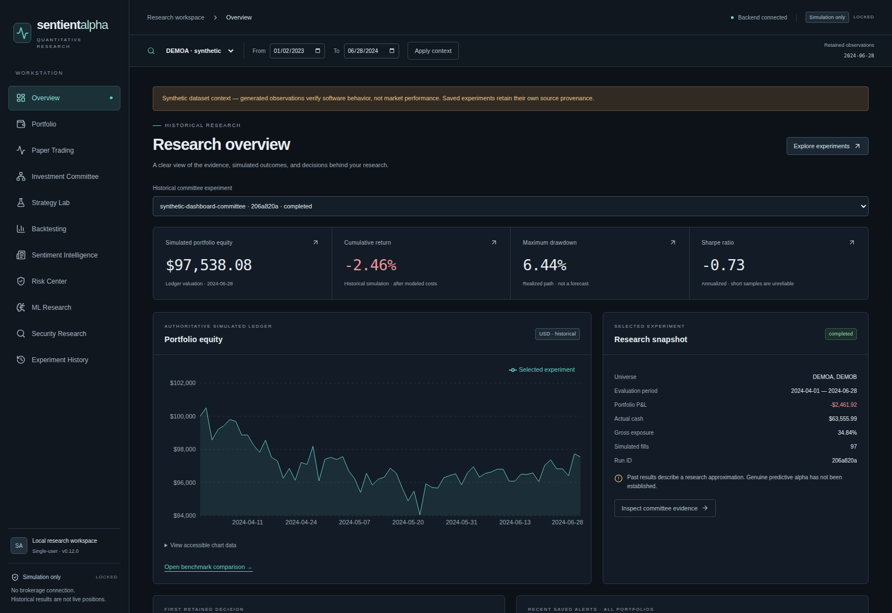
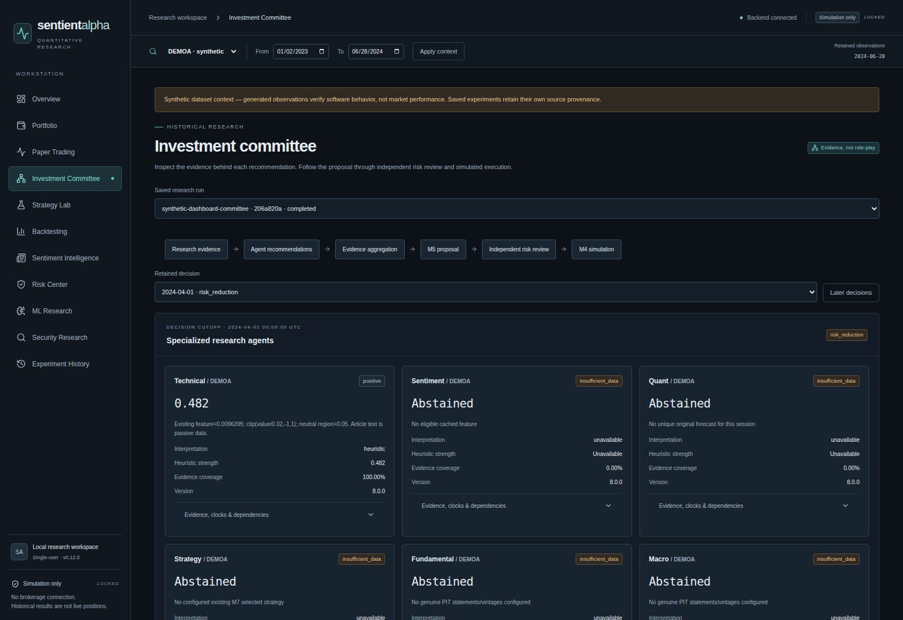
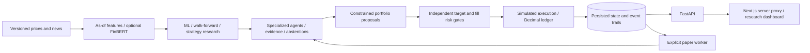

# SentientAlpha — Auditable Multi-Agent Quant Research

**v0.12.0 · Python / FastAPI / Next.js · research and simulation only**

SentientAlpha is a local quantitative research workstation built to make portfolio decisions inspectable: which observations were eligible, why an agent acted or abstained, whether independent risk controls approved the proposal, and whether simulated holdings survive a restart.

I built it to study the engineering between a research signal and a recoverable portfolio. Six deterministic research adapters—technical, sentiment, quant, strategy, fundamental and macro—produce structured evidence or explicit abstentions. They do not role-play an investment committee. Their recommendations feed dependency-aware aggregation, portfolio optimization, independent risk review and simulated execution.

**The engineering is verified more strongly than the economics. Robust predictive alpha has not been established.** The genuine historical IBM committee evaluation lost **8.70% versus buy-and-hold's 4.69% loss**. Missing evidence stays missing; synthetic demonstrations establish software behavior, not market skill.

## See the workstation

Actual Chromium renders of the offline synthetic demonstration. Every displayed security, observation and simulated trade in these images is generated; returns are illustrative software output. This public repository is source for inspection, **not a hosted trading application**.





Also inspect the full [risk dashboard](docs/screenshots/risk.png) and [paper-trading dashboard](docs/screenshots/paper.png). [Capture provenance and reproduction](docs/PORTFOLIO_REVIEW.md#screenshot-provenance) explain the selected sessions and exact generator.

## Engineering capabilities

- **Time-safe research:** revision-preserving ingestion, as-of features, matured labels, training-only preprocessing and purged walk-forward evaluation; optional pinned FinBERT.
- **Auditable decisions:** persisted agent evidence, clocks, dependency groups, disagreement and honest abstention; bounded strategy discovery and constrained portfolio proposals.
- **Independent risk authority:** exposure, concentration, stress and VaR/CVaR gates at proposal and fill time; insufficient evidence can veto a trade.
- **Durable simulated accounting:** modeled execution costs, a Decimal ledger, atomic fills, idempotent commands, replay and crash/restart recovery.
- **Inspectable full stack:** eleven dashboard routes, backend-owned calculations, typed API contracts and automated browser/accessibility checks across desktop and mobile widths.

## Verification and research findings

| Evidence | What it establishes | Limit |
|---|---|---|
| [Merged release verification](docs/VERIFICATION.md) | 55 hosted browser checks; 44 route/viewport accessibility/layout cases; Python 3.12/3.14 and PostgreSQL integration | Automated checks do not certify deployment, complete accessibility or profitable trading |
| [Reproducible offline demo](DEMO.md) | Actual research engines; five persisted paper fills; separate zero-fill risk veto; equivalent replay | Entirely synthetic; five of six agent types abstain per asset in this fixture |
| [Genuine IBM committee](docs/RESEARCH_RESULTS.md) | −8.6995% vs buy-and-hold −4.6899% | Short retrospective sample; not a fresh holdout or live result |
| [ML, discovery and risk](docs/RESEARCH_RESULTS.md) | No reliable predictive advantage established; selected strategy lost/lagged baselines; risk reduced exposure | Incomplete coverage, inspected holdouts, short tails and no long forward record |
| [Earlier 40-stock study](docs/HISTORICAL_STUDY_REVIEW.md) | v0.6 source, protocol, summaries and original input hashes located | Performance not independently reproduced; no v0.12 performance claim |

**[Follow the 5–10 minute demonstration →](DEMO.md)** Installation and execution require the owner's separate permission under [LICENSE](LICENSE); the instructions below do not grant it. No paid API key, brokerage account or model download is needed for the base synthetic demo.

## Architecture and data flow



Python 3.12/3.14, FastAPI, SQLAlchemy/Alembic, NumPy, pandas, SciPy and scikit-learn power the backend. Next.js 16, React, TypeScript, Tailwind, Recharts and Lucide power the dashboard. SQLite supports the verified local workflow; PostgreSQL support has additional infrastructure checks described below.

Financial calculations remain backend-owned. Equity reconciles cash plus marked positions; returns use successive equity ratios net of modeled costs. Historical Sharpe uses sample daily volatility and √252 annualization with a zero risk-free convention. Undefined statistics stay unavailable. See [architecture](ARCHITECTURE.md), [backtesting conventions](docs/BACKTESTING_ENGINE.md), [portfolio optimization](docs/PORTFOLIO_OPTIMIZATION.md) and the milestone documentation (historical evidence archived locally).

## Installation and offline demonstration

These instructions are for the owner or separately authorized local evaluators. They do not grant execution, reuse or redistribution rights beyond LICENSE. Use Python 3.12 and Node 24; no paid key, GPU or model download is required for the base demo. Downloaded dependencies remain separate from this repository.

```sh
python3.12 -m venv .venv
source .venv/bin/activate
python -m pip install -r requirements-runtime.lock
python -m pip install --no-deps -e .
npm --prefix frontend ci
PYTHONPATH=backend python scripts/release_demo.py --database ./demo.db --report ./demo.json
export DATABASE_URL=sqlite:///./demo.db
python -m uvicorn sentientalpha.api.app:create_app --factory --host 127.0.0.1 --port 8000
```

In a second terminal at the repository root:

```sh
npm --prefix frontend run build
npm --prefix frontend run start
```

Open [the local dashboard](http://127.0.0.1:3000) and follow the [5–10 minute engineering demonstration](DEMO.md). The generator refuses existing database/report paths. A normal paper session and a separate zero-fill risk-veto session demonstrate actual persisted behavior. Sentiment correctly shows unavailable evidence when no eligible news exists.

For an empty manually configured database, activate the environment and run `python -m alembic upgrade head`. The release demo applies migrations automatically. Never use regression-test databases for personal or production data.

| Server environment setting | Purpose |
|---|---|
| `SENTIENTALPHA_MODE` | Defaults to `simulation`; live mode is rejected. |
| `DATABASE_URL` | Explicit SQLite path or separately provisioned PostgreSQL+psycopg URL. |
| `API_BASE_URL` | Next server upstream; default loopback API port 8000. Set explicitly for alternate ports. |
| `DASHBOARD_ORIGINS` | Allowed local dashboard origins; match custom ports. |
| `TRUSTED_HOSTS` | Restricted server host allowlist; keep loopback defaults locally. |
| `ALPHA_VANTAGE_API_KEY` | Optional private server credential for entitled genuine-provider requests; unnecessary offline. |
| `FINBERT_CACHE_DIR` | Optional separately downloaded model cache, subject to the model's independent terms. |

Python does not automatically load environment files. No `.env.example` is distributed. Never place credentials in `NEXT_PUBLIC` variables. See [deployment, backup and recovery](DEPLOYMENT.md) for exact operational settings. Optional NLP uses `requirements-nlp.lock`; follow [sentiment documentation](docs/SENTIMENT_ENGINEERING.md) and the [model audit](THIRD_PARTY_MATERIALS.md). No model weights are bundled.

## Verification

**Browser verification:** the repair now merged into main passed 55 hosted Playwright checks, including 44 route/viewport axe, focus and layout cases. See the branch-specific verification record and remaining operational limits below.

The cleaned GitHub candidate is tested independently of the original release. [Verification](docs/VERIFICATION.md) distinguishes baseline execution, cleanup reruns, the independent browser-repair branch and remaining gaps. Redundant historical machine reports are archived locally; useful research reports remain.

```sh
python -m pip install -r requirements.lock
python -m pytest -q
python -m ruff check .
python -m ruff format --check .
python -m mypy
npm --prefix frontend run typecheck
npm --prefix frontend run lint
npm --prefix frontend run format:check
npm --prefix frontend test
npm --prefix frontend run build
python scripts/release_scan.py
```

The optional real-model test requires its pinned dependencies/cache and `RUN_FINBERT=1`; Python 3.14 core deliberately skips that test. CI includes disposable PostgreSQL and browser checks, but configuration alone does not establish a pass. See the linked verification record for actual execution status. Local Docker runtime and native PostgreSQL initialization have documented host restrictions; hosted CI supplies browser/axe verification.

## Research and operational limitations

Real, synthetic, simulated and benchmark evidence are labeled separately. Genuine sentiment, fundamental and macro coverage is incomplete; short tails limit risk inference; execution is approximate; strategy selection can overfit; and no long forward operating record establishes predictive performance. Risk controls reduced reported exposure/losses without establishing alpha.

This is a single-user local workstation without production authentication, tenant isolation or deployment certification. It is not production-ready trading software, financial advice or a promise of returns. Restricted provider exports and the five genuine-data screenshots remain excluded; permitted but unnecessary historical screenshots/diagnostics are now archived locally. Original negative findings remain in the reports. Required generators and approved synthetic fixtures are retained. [Evidence retention and publication selection](docs/EVIDENCE.md) identifies exactly what was omitted.

## Technical review and rights

Start with [architecture](ARCHITECTURE.md), [demo](DEMO.md), [paper-trading design](docs/PAPER_TRADING.md), backend services under `backend/sentientalpha`, tests under `backend/tests`, the migration chain through `0012_paper_operations`, and frontend component/browser tests. The [research findings](docs/RESEARCH_RESULTS.md) and retained research reports explain engineering tradeoffs and negative results.

**Copyright © 2026 Kathan Patel. All Rights Reserved.** Original controlled source is available for inspection and evaluation under [LICENSE](LICENSE), without a general license to reuse, execute, modify, distribute or commercially exploit it. GitHub hosting-service and applicable-law rights remain as stated in LICENSE. Third-party software, icons, scaffolds, data and models retain their independent terms; see [THIRD_PARTY_NOTICES.md](THIRD_PARTY_NOTICES.md) and [THIRD_PARTY_MATERIALS.md](THIRD_PARTY_MATERIALS.md). The repository is public for inspection; public visibility does not grant general execution or reuse permission.


## Development provenance

The project was developed before this public repository snapshot. The GitHub history begins with a cleaned source snapshot; historical local milestone/release archives were preserved separately. Those archives are not an invented incremental GitHub development history. The earlier Mac v0.6 implementation is a separate code line whose results have not been ported to v0.12. See [evidence retention](docs/EVIDENCE.md) and the [historical-study review](docs/HISTORICAL_STUDY_REVIEW.md).
