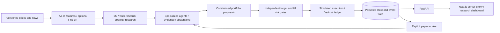

# SentientAlpha — A Multi-Agent Quantitative Research and Portfolio Simulation Platform

**v0.12.0 · research and simulation only · no brokerage or real-money execution.**

SentientAlpha connects versioned financial data, time-safe research, specialized agents, independent risk controls and a durable simulated portfolio. It explores a practical engineering question: can every decision be traced to eligible evidence, vetoed independently, and recovered consistently after a process failure?

The strongest contributions are temporal correctness, auditable decisions and recovery—not demonstrated trading profitability. **Robust alpha has not been established by the limited real-market evaluations.** The historical genuine IBM committee result was **−8.70% versus buy-and-hold −4.69%**. The offline demonstration is synthetic and executes the actual research and accounting services.

## What is implemented

- Revision-preserving ingestion, as-of technical/quantitative features, fundamental research interfaces and provenance checks.
- Training-only preprocessing, matured labels, purged walk-forward validation, calibration and reproducible model evaluation; optional pinned FinBERT sentiment integration.
- Bounded strategy discovery, benchmark comparisons, explicit holdout handling and constrained portfolio optimization.
- Fundamental, technical, sentiment, macro, quant and strategy agents with persisted evidence, independent evidence groups and honest abstentions. Genuine fundamental/macro/news coverage remains incomplete.
- Independent exposure, concentration, stress and VaR/CVaR controls; target and fill-time vetoes with observation/reliability gates.
- Historical backtesting with modeled execution costs and a Decimal ledger; persistent paper sessions with atomic fills, idempotent commands, replay and crash/restart recovery.
- Eleven dashboard routes covering overview, security research, ML, strategies, committee, portfolio, risk, backtesting, sentiment, history and paper trading.

## Architecture and data flow



Python 3.12/3.14, FastAPI, SQLAlchemy/Alembic, NumPy, pandas, SciPy and scikit-learn power the backend. Next.js 16, React, TypeScript, Tailwind, Recharts and Lucide power the dashboard. SQLite supports the verified local workflow; PostgreSQL support has additional infrastructure checks described below.

Financial calculations remain backend-owned. Equity reconciles cash plus marked positions; returns use successive equity ratios net of modeled costs. Historical Sharpe uses sample daily volatility and √252 annualization with a zero risk-free convention. Undefined statistics stay unavailable. See [architecture](ARCHITECTURE.md), [backtesting conventions](docs/BACKTESTING_ENGINE.md), [portfolio optimization](docs/PORTFOLIO_OPTIMIZATION.md) and the [milestone documentation](ROADMAP.md).

## Installation and offline demonstration

These instructions are for the owner or separately authorized local evaluators. They do not grant execution, reuse or redistribution rights beyond LICENSE. Use Python 3.12 and Node 24; no paid key, GPU or model download is required for the base demo. Downloaded dependencies remain separate from this repository.

```sh
python3.12 -m venv .venv
source .venv/bin/activate
python -m pip install -r requirements-runtime.lock
python -m pip install --no-deps -e .
npm --prefix frontend ci
PYTHONPATH=backend python scripts/release_demo.py --database ./demo.db --report ./demo.json
export DATABASE_URL=sqlite:///./demo.db
python -m uvicorn sentientalpha.api.app:create_app --factory --host 127.0.0.1 --port 8000
```

In a second terminal at the repository root:

```sh
npm --prefix frontend run build
npm --prefix frontend run start
```

Open [the local dashboard](http://127.0.0.1:3000) and follow the [5–10 minute engineering demonstration](DEMO.md). The generator refuses existing database/report paths. A normal paper session and a separate zero-fill risk-veto session demonstrate actual persisted behavior. Sentiment correctly shows unavailable evidence when no eligible news exists.

For an empty manually configured database, activate the environment and run `python -m alembic upgrade head`. The release demo applies migrations automatically. Never use regression-test databases for personal or production data.

| Server environment setting | Purpose |
|---|---|
| `SENTIENTALPHA_MODE` | Defaults to `simulation`; live mode is rejected. |
| `DATABASE_URL` | Explicit SQLite path or separately provisioned PostgreSQL+psycopg URL. |
| `API_BASE_URL` | Next server upstream; default loopback API port 8000. Set explicitly for alternate ports. |
| `DASHBOARD_ORIGINS` | Allowed local dashboard origins; match custom ports. |
| `TRUSTED_HOSTS` | Restricted server host allowlist; keep loopback defaults locally. |
| `ALPHA_VANTAGE_API_KEY` | Optional private server credential for entitled genuine-provider requests; unnecessary offline. |
| `FINBERT_CACHE_DIR` | Optional separately downloaded model cache, subject to the model's independent terms. |

Python does not automatically load environment files. No `.env.example` is distributed. Never place credentials in `NEXT_PUBLIC` variables. See [deployment, backup and recovery](DEPLOYMENT.md) for exact operational settings. Optional NLP uses `requirements-nlp.lock`; follow [sentiment documentation](docs/SENTIMENT_ENGINEERING.md) and the [model audit](THIRD_PARTY_MATERIALS.md). No model weights are bundled.

## Verification

**Publication gate: blocked.** Hosted browser CI completed with 4 passes and 45 failures involving label locators and portfolio heading structure; axe/layout checks were not reached. Backend, PostgreSQL and security jobs passed.

The cleaned GitHub candidate is tested independently of the original release. Current results and a before/after comparison are recorded in [GITHUB_PORTFOLIO_PREPARATION.md](GITHUB_PORTFOLIO_PREPARATION.md); older reports remain dated historical evidence.

```sh
python -m pip install -r requirements.lock
python -m pytest -q
python -m ruff check .
python -m ruff format --check .
python -m mypy
npm --prefix frontend run typecheck
npm --prefix frontend run lint
npm --prefix frontend run format:check
npm --prefix frontend test
npm --prefix frontend run build
python scripts/release_scan.py
```

The optional real-model test requires its pinned dependencies/cache and `RUN_FINBERT=1`; Python 3.14 core deliberately skips that test. CI includes disposable PostgreSQL and browser checks, but configuration alone does not establish a pass. See the current preparation report for actual execution status. Local Docker runtime, native PostgreSQL initialization and current browser/axe verification have documented host/tool restrictions.

## Research and operational limitations

Real, synthetic, simulated and benchmark evidence are labeled separately. Genuine sentiment, fundamental and macro coverage is incomplete; short tails limit risk inference; execution is approximate; strategy selection can overfit; and no long forward operating record establishes predictive performance. Risk controls reduced reported exposure/losses without establishing alpha.

This is a single-user local workstation without production authentication, tenant isolation or deployment certification. It is not production-ready trading software, financial advice or a promise of returns. Historical provider exports and five genuine-data screenshots held for rights review are excluded; original negative findings remain in the reports. Required generators and approved synthetic fixtures are retained. [Publication selection](PUBLICATION_SELECTION.md) identifies exactly what was omitted.

## Technical review and rights

Start with [architecture](ARCHITECTURE.md), [demo](DEMO.md), [paper-trading design](docs/PAPER_TRADING.md), backend services under `backend/sentientalpha`, tests under `backend/tests`, the migration chain through `0012_paper_operations`, and frontend component/browser tests. The [portfolio presentation](PORTFOLIO_PRESENTATION.md) and milestone reports explain engineering tradeoffs and negative results.

**Copyright © 2026 Kathan Patel. All Rights Reserved.** Original controlled source is available for inspection and evaluation under [LICENSE](LICENSE), without a general license to reuse, execute, modify, distribute or commercially exploit it. GitHub hosting-service and applicable-law rights remain as stated in LICENSE. Third-party software, icons, scaffolds, data and models retain their independent terms; see [THIRD_PARTY_NOTICES.md](THIRD_PARTY_NOTICES.md) and [THIRD_PARTY_MATERIALS.md](THIRD_PARTY_MATERIALS.md). Public visibility remains solely the owner's later decision.
