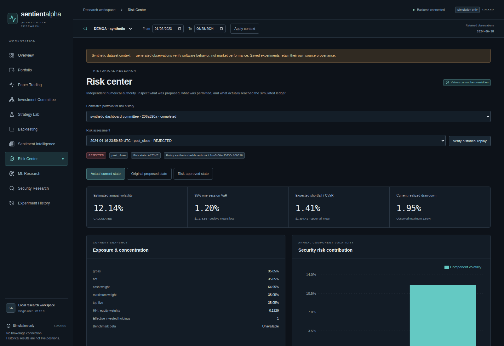
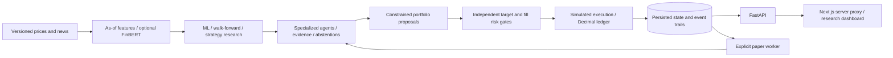

# SentientAlpha — Auditable Multi-Agent Quant Research

**v0.12.0 · Python / FastAPI / Next.js · research and simulation only**

SentientAlpha is a local quantitative research workstation built to make portfolio decisions inspectable: which observations were eligible, why an agent acted or abstained, whether independent risk controls approved the proposal, and whether simulated holdings survive a restart.

I built it to study the engineering between a research signal and a recoverable portfolio. Six deterministic research adapters—technical, sentiment, quant, strategy, fundamental and macro—produce structured evidence or explicit abstentions. They do not role-play an investment committee. Their recommendations feed dependency-aware aggregation, portfolio optimization, independent risk review and simulated execution.

**The engineering is verified more strongly than the economics. Robust predictive alpha has not been established.** The genuine historical IBM committee evaluation lost **8.70% versus buy-and-hold's 4.69% loss**. Missing evidence stays missing; synthetic demonstrations establish software behavior, not market skill.

## See the workstation

Actual Chromium renders of the offline synthetic demonstration. Every displayed security, observation and simulated trade in these images is generated; returns are illustrative software output. This public repository is source for inspection, **not a hosted trading application**.




The [paper-trading dashboard](docs/screenshots/paper.png) shows persisted simulated holdings and cash. See [screenshot provenance and reproduction](docs/PORTFOLIO_REVIEW.md#screenshot-provenance).

## Engineering capabilities

- **Time-safe research:** revision-preserving ingestion, as-of features, matured labels, training-only preprocessing and purged walk-forward evaluation; optional pinned FinBERT.
- **Auditable decisions:** persisted agent evidence, clocks, dependency groups, disagreement and honest abstention; bounded strategy discovery and constrained portfolio proposals.
- **Independent risk authority:** exposure, concentration, stress and VaR/CVaR gates at proposal and fill time; insufficient evidence can veto a trade.
- **Durable simulated accounting:** modeled execution costs, a Decimal ledger, atomic fills, idempotent commands, replay and crash/restart recovery.
- **Inspectable full stack:** eleven dashboard routes, backend-owned calculations, typed API contracts and automated browser/accessibility checks across desktop and mobile widths.

## Verification and research findings

| Evidence                                                  | What it establishes                                                                                                 | Limit                                                                                    |
| --------------------------------------------------------- | ------------------------------------------------------------------------------------------------------------------- | ---------------------------------------------------------------------------------------- |
| [Engineering verification](docs/VERIFICATION.md)          | 56 hosted browser checks; 44 route/viewport accessibility/layout cases; Python 3.12/3.14 and PostgreSQL integration | Automated checks do not certify deployment, complete accessibility or profitable trading |
| [Reproducible offline demo](DEMO.md)                      | Actual research engines; five persisted paper fills; separate zero-fill risk veto; equivalent replay                | Entirely synthetic; five of six agent types abstain per asset in this fixture            |
| [Genuine IBM committee](docs/RESEARCH_RESULTS.md)         | −8.6995% vs buy-and-hold −4.6899%                                                                                   | Short retrospective sample; not a fresh holdout or live result                           |
| [ML, discovery and risk](docs/RESEARCH_RESULTS.md)        | No reliable predictive advantage established; selected strategy lost/lagged baselines; risk reduced exposure        | Incomplete coverage, inspected holdouts, short tails and no long forward record          |
| [Earlier 40-stock study](docs/HISTORICAL_STUDY_REVIEW.md) | v0.6 source, protocol, summaries and original input hashes located                                                  | Performance not independently reproduced; no v0.12 performance claim                     |

**[Follow the 5–10 minute demonstration →](DEMO.md)** The base synthetic demo needs no paid API key, brokerage account or model download.

## Committee evidence


Five agent types abstain in the baseline synthetic demo because they lack eligible evidence; only the technical adapter participates per asset. Missing inputs are not neutral votes or independent investment opinions. [Demo coverage](DEMO.md#committee-coverage) explains each abstention and the evidence inspector.

## Architecture and data flow



Python 3.12/3.14, FastAPI, SQLAlchemy/Alembic, NumPy, pandas, SciPy and scikit-learn power the backend. Next.js 16, React, TypeScript, Tailwind, Recharts and Lucide power the dashboard. SQLite supports the verified local workflow; PostgreSQL integration is also tested in CI.

Financial calculations remain backend-owned. Equity reconciles cash plus marked positions; returns use successive equity ratios net of modeled costs. Historical Sharpe uses sample daily volatility and √252 annualization with a zero risk-free convention. Undefined statistics stay unavailable. See [architecture](ARCHITECTURE.md), [backtesting conventions](docs/BACKTESTING_ENGINE.md), [portfolio optimization](docs/PORTFOLIO_OPTIMIZATION.md).

## Installation and offline demonstration

For the owner or separately authorized evaluators under [LICENSE](LICENSE). Use Python 3.12 and Node 24; these instructions grant no execution or reuse permission.

```sh
python3.12 -m venv .venv
source .venv/bin/activate
python -m pip install -r requirements-runtime.lock
python -m pip install --no-deps -e .
npm --prefix frontend ci
PYTHONPATH=backend python scripts/release_demo.py --database ./demo.db --report ./demo.json
export DATABASE_URL=sqlite:///./demo.db
python -m uvicorn sentientalpha.api.app:create_app --factory --host 127.0.0.1 --port 8000
```

In a second terminal at the repository root:

```sh
npm --prefix frontend run build
npm --prefix frontend run start
```

Open [the local dashboard](http://127.0.0.1:3000) and follow [DEMO.md](DEMO.md). Use new database/report paths: the generator refuses existing files and applies migrations automatically. The normal session has five persisted simulated fills; a separate PAUSED risk-veto session has zero. No eligible news is seeded.

Keep servers bound to loopback. Python does not automatically load environment files; never put credentials in `NEXT_PUBLIC` variables. See [configuration, backup and recovery](DEPLOYMENT.md) for `DATABASE_URL`, alternate `API_BASE_URL` ports, origin/host allowlists and manual migrations. Never use regression-test databases for personal or production data.

## Reproduce verification

Install `requirements.lock` for developer checks, then run backend `pytest`, Ruff and mypy, frontend `typecheck`, `lint`, `format:check`, `test`, `generate:api` and `build`, and `python scripts/release_scan.py`. [Verification](docs/VERIFICATION.md#reproduce-authorized-checks) documents exact commands, disposable PostgreSQL checks and browser fixtures; generated API types must remain unchanged.

Optional FinBERT requires separate pinned dependencies/cache and `RUN_FINBERT=1`; the core suite skips that test. Follow [sentiment setup](docs/SENTIMENT_ENGINEERING.md) and [model terms](THIRD_PARTY_MATERIALS.md). No model weights are bundled or needed for the base demo.

## Limitations and rights

Genuine sentiment, fundamental and macro coverage is incomplete. Short samples/tails, inspected holdouts, strategy-selection overfitting and approximate execution limit inference; lower exposure/losses under risk controls do not establish alpha. No long forward operating record demonstrates predictive performance. The [research findings](docs/RESEARCH_RESULTS.md) preserve negative results; the [old v0.6 Sharpe figures remain unreproduced](docs/HISTORICAL_STUDY_REVIEW.md) and are not v0.12 results.

This is a single-user local workstation without production authentication, tenant isolation or deployment certification. Docker application runtime and full manual accessibility remain unverified. It is not production-ready trading software, financial advice or a promise of returns. Restricted provider exports are not distributed; real, synthetic, simulated and benchmark evidence are labeled separately. Review [security limits](SECURITY.md) before running it.

**Copyright © 2026 Kathan Patel — All Rights Reserved.** Public inspection does not grant general execution, modification, redistribution or commercial reuse rights; see [LICENSE](LICENSE), including applicable-law and GitHub hosting rights. Third-party dependencies, icons, data and models retain their own terms: [notices](THIRD_PARTY_NOTICES.md) and [materials](THIRD_PARTY_MATERIALS.md).
