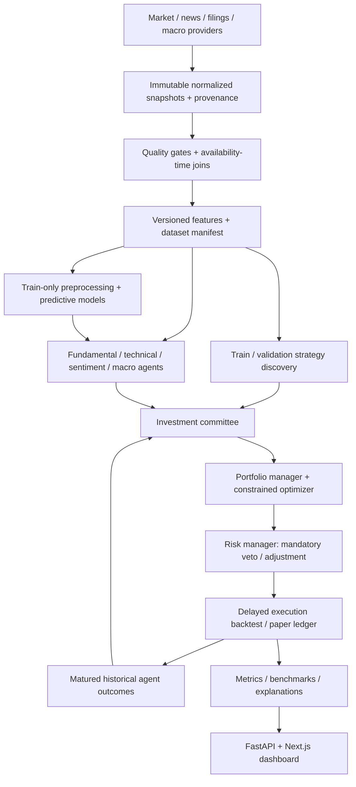

# SentientAlpha — system architecture

Status: full-platform design; **Milestones 1–12 implemented locally; verification limits are documented per milestone**.
Local SQLite/API and live public IBM retrieval are verified. Native PostgreSQL initialization
and Docker runtime are blocked; WebAssembly PostgreSQL fallback has failed negative tests.
See [hardening report](HARDENING_REPORT.md) and [feature architecture](FEATURE_ENGINEERING.md) and [M2 report](MILESTONE2_REPORT.md).
The initial repository was empty. No existing application or conventions were replaced.

## Scope and hard boundaries

An end-of-day, long-only US equity/ETF research platform for 20–50 configurable symbols.
Research, backtesting and simulated execution are the only supported modes. No broker
adapter, brokerage credentials or live-order endpoint exists. Initial data resolution is
daily, USD; intraday, derivatives, short borrow and margin are outside the initial scope.
Start with $100,000 simulated capital, configurable costs and explicit cash allocation.
A current-symbol sample is a convenience universe, not a survivorship-free historical index.

The first delivery is infrastructure and market data, followed by independently testable
research modules. Unimplemented APIs and UI screens are not exposed as working features.
Synthetic data is reproducible test/demo data, never evidence of investment performance.

## Technology decisions

| Layer | Choice | Reason |
|---|---|---|
| Domain | Python 3.12+, typed immutable records | Deterministic calculations, independently testable without web services |
| API | FastAPI, Pydantic 2 | Validated requests, typed responses, OpenAPI |
| Persistence | SQLAlchemy 2, Alembic; PostgreSQL 16 deployment, SQLite local | One model and migration path; no local server needed for demo |
| Data | Provider protocol, Alpha Vantage raw daily adapter, seeded synthetic adapter | Interchangeable connectors, explicit provenance |
| Session validation (M1 hardening) | exchange-calendars XNYS | Holidays, scheduled closes, DST; versioned audit diagnostics |
| Features (M2, implemented) | NumPy, pandas; immutable SQL snapshots | Transparent trailing formulas, causal clocks and matrix assembly |
| Later research (M3–9) | SciPy, scikit-learn and sentiment dependencies as needed | Deferred until the relevant milestone |
| Sentiment (M3) | Hugging Face transformers + pinned FinBERT revision | Finance NLP; preserve full class probabilities and model provenance |
| Optimization (M5) | SciPy constrained solvers initially | Bounds, cash, sectors, turnover; explicit infeasibility handling |
| Frontend (M10) | Next.js, TypeScript, Tailwind, shadcn/ui, Recharts | Typed, dense interactive research UI |
| Jobs (before expensive research) | Separate worker, DB job table and leases | API stays responsive; add Redis only if queue throughput justifies it |
| Experiments | SQL experiment registry + immutable filesystem artifacts | Config/data/model hashes and complete splits; MLflow optional later |
| Delivery | Docker Compose, pytest/unittest, Ruff, GitHub Actions | Local repeatability and PostgreSQL integration checks |

Provider entitlements are not assumed. Alpha Vantage's compact daily endpoint supplies a
limited recent window; full history and adjusted data can require paid access. Milestone 1
requests compact **raw OHLCV only**. It refuses incomplete requested date ranges. No
2018–2026 real-data demo is claimed without a licensed historical source. See the
[provider documentation](https://www.alphavantage.co/documentation/).

## Components and data flow



Every transition records an experiment ID and input versions. Data acquisition is separate
from analysis: an API read never silently downloads data. Every reported number is computed,
with units, horizon, timestamp and provenance. LLM prose is optional and may only summarize
validated records; no LLM participates in price calculations or order routing.

## Repository layout

```text
backend/sentientalpha/
  api/             # request/response schemas and HTTP application [M1]
  data/            # provider interfaces, validation, synthetic + HTTP adapter [M1]
  database/        # ORM models, sessions, snapshot repository [M1]
  services/        # transactional ingestion [M1]
  features/        # registry, kernels, causal clocks, snapshots and matrices [M2 implemented]
  sentiment/       # inference and rolling aggregates [M3]
  backtesting/     # ledger and walk-forward evaluator [M4]
  optimization/    # constrained objectives [M5]
  ml/              # PIT targets, safe numeric models, purged folds, artifacts [M6 implemented]
  strategies/      # bounded grammar/search, validation locks and M4 integration [M7 implemented]
  committee/       # typed evidence, M6/M7 adapters, M5 veto, M4 targets, audit/replay [M8 implemented]
  risk/            # pre-trade and portfolio risk [M9]
  execution/       # paper orders and fills [M11]
backend/tests/     # unit, API, DB, temporal and integration tests
migrations/        # immutable Alembic revisions
config/            # universe and explicit research configuration
frontend/          # Next.js app/components/hooks/lib/types [M10]
research/          # notebooks and experiment reports [M6 onward]
docs/              # architecture, methodology, roadmap, operations
```

Future directories are a plan, not empty placeholder packages.

## Data contracts and temporal correctness

A price snapshot contains `session_date`, scheduled `session_close_at`, acquisition
`observed_at`, raw OHLCV, optional adjusted close, `available_at`, `ingested_at`, source,
synthetic flag, calendar, adjustment status, currency, quality flags, revision number and checksum.
Legacy close/acquisition timestamps remain null. Calendar close is not a provider publication
instant. New prices round-trip exactly: PostgreSQL NUMERIC(20,8), SQLite validated fixed-width
21-character decimal text. Source precision normalization is eight places, HALF_EVEN;
legacy SQLite precision cannot be reconstructed and is explicitly flagged during migration.
Dates describe sessions; timestamps are UTC instants. The Alpha Vantage adapter does not
claim to know historical publication instants: it marks `available_at` at acquisition and
`availability_kind=observed`. Synthetic bars have an explicit modeled next-day availability
and `availability_kind=modeled`. A future PIT provider may assert `verified` publication times.

At the application boundary, price revisions append rows; content matching the latest revision is deduplicated (reversions remain revisions). Querying `as_of` requires
both availability and ingestion at or before the cutoff and selects the newest visible
snapshot for each session. A newly acquired historical bar is therefore not visible in a
past strict as-of query. Reconstructing historical research from today's downloads will
require explicit matrix research mode, a label in results, and cannot be called verified historical PIT.
Do not substitute today's adjusted closes into historical features: adjustment factors can
contain future corporate actions. M4 will require action-aware total-return accounting or
reject datasets without required split/dividend records.

Fundamentals are keyed by reporting period and publication/filing time, not fiscal year-end.
Macro observations have release and vintage dates. News has published, observed and
available timestamps; deduplicate syndication before aggregation. No backward fill from
future observations. Asset universe membership is effective-dated; delistings and stale
prices require explicit policies. Missing bars are surfaced, never silently forward-filled.

## Database design

All IDs are stable UUID strings; timestamps UTC. Core relationships use foreign keys.
Detailed columns and rollout are in [DATABASE.md](DATABASE.md). M1 creates assets,
ingestion_runs and market_prices with application-level append-only revisions, deterministic
revision ordering, timestamp/provenance checks and range indexes. Hardening adds two migrations
without rewriting revision 0001. Privileged database administrators can still alter records.

Later migrations add universes/memberships, fundamentals, corporate actions, macro vintages,
news and sentiment, feature datasets, model versions, experiments, strategies/backtests,
agent signals/performance, committee decisions, portfolios/positions, orders/fills/risk.
Portfolio results reference exact input dataset and model versions rather than mutable rows.
Users/authentication are introduced before any remotely accessible multi-user deployment.

## Agents, portfolio manager and committee

Implemented in `committee/`: bounded typed recommendations with distinct abstentions; online/research/retrospective
source clocks; original M6 forecasts and validation-locked M7 rules; declared dependency groups; fixed prior weights;
M5 constrained proposals and independent vetoes; and M4 next-open orders/ledger. Confidence and expected return
remain null without empirical justification. Fundamental/macro interfaces abstain without genuine coverage.

Migration0010 adds durable committee parents/ordered decisions and foreign-key M4 ledger links. Raw market datasets
and execution accounting are reused. Replay checks build/dependencies, frozen derived evidence/source hashes,
reconstructed decisions and actual M4 artifacts. Rollback tests cover a failure after ledger flush. See
[MULTI_AGENT_SYSTEM.md](MULTI_AGENT_SYSTEM.md) for policies, bounds, risk checks and source limitations.

Adaptive/regime weight learning, fitted agent correlations and independently validated confidence are future research;
fixed priors are explicit preferences. Historical availability modeling is not proof of contemporaneous live issuance.

## ML and strategy discovery

Prediction targets: next-session/5-session direction, return and volatility. Baselines:
zero return, historical mean, logistic/ridge, then gradient boosting if validation improves.
Preprocessors fit on train only. Purge observations whose label spans a boundary; apply an
embargo at least as long as the target horizon. Record data hash, seed, feature schema,
training cutoff, hyperparameters, library versions and artifact digest. Permutation importance
uses validation data; feature selection never uses final test.

Strategies are bounded typed ASTs, not executable strings or `eval`. Begin with seeded random
search over at most three conjunctions: indicator thresholds, sentiment features and regime
filters. Rank by validation with complexity/turnover penalties and minimum completed-trade
count. Preserve all candidates and failures. Lock the selected rules before evaluating test
exactly once; report fold dispersion and comparisons to SPY, equal-weight, buy-and-hold and
minimum variance. Multiple trials are logged; strong holdout results are not proof of alpha.

## API and jobs

M1: health/readiness, bounded assets, ingestion, UUID ingestion status, paginated market
snapshots. Typed errors suppress input echoes; failed ingestions have sanitized run IDs and
codes. Quality diagnostics are stored per run; suspicious rows are flagged rather than repaired. CLI
handles seeds and provider ingestion. Small bounded ingestion is synchronous in M1; expensive
research uses `POST -> 202 + job_id`, poll/cancel/status, bounded concurrency and persisted errors.

Planned API: GET sentiment/agents by ticker; POST committee/analyze, backtest,
strategies/discover, portfolio/optimize and research; GET strategies, portfolio/current,
risk and performance. Responses include units, window, provenance and experiment version.
No fabricated successful responses for unimplemented routes.

## Frontend design

Eight routes: overview, portfolio, committee, strategy lab, backtest, sentiment, risk, research.
Use charcoal surfaces, off-white text, restrained cyan accents, tabular numerals and a persistent
SIMULATION badge. Distinguish synthetic, historical reconstructed and verified PIT datasets.
Display empty/loading/error states and data freshness. Keyboard-accessible controls and chart
text summaries; red/green is never the only cue. Committee cards trace each feature to evidence.
Strategy lab validates chronological dates and freezes holdout before submission. Screenshots
will come from the working app in M10, not mock results made to look implemented.

## Deployment and operations

Local: SQLite + loopback-only FastAPI, no network needed for synthetic generation.
Compose: PostgreSQL healthcheck -> one-shot migrations -> API. Compose configuration was
validated with the official v2.39.4 CLI; container build/start is not verified because no Docker
daemon exists. The API uses a nonroot read-only container, drops capabilities, and has temporary
/tmp storage. A separate password variable avoids manual URL escaping. Native PostgreSQL 16.2
initdb failed on denied shared memory. PostgreSQL 18.6/PGlite only partially verifies SQL dialect:
full-suite negative transaction tests failed its protocol multiplexer; do not deploy that fallback. Database has an internal
network address only; API binds host loopback. No public hosting in M1. Full deployment later:
TLS reverse proxy -> authenticated Next.js/API -> isolated worker and PostgreSQL; artifact
volume/object store, backups, database restore drills and job leases. Schema migrations run
once per release, not simultaneously inside all API replicas. No Redis or Kubernetes initially.

Structured application logs contain event, run ID, row count and error code; no keys/request
URLs. PostgreSQL connection timeouts and statement/lock timeouts are bounded; SQL parameters
are hidden in SQLAlchemy exceptions. API shutdown and failed migrations dispose engines.
Health distinguishes liveness and database/schema readiness. Provider requests have timeouts,
bounded retry on transient failures and redacted errors; quota messages fail visibly.
Batch writes are atomic. Duplicate ingestion is idempotent; revisions retain history.
SQLite obtains a writer reservation before reads; PostgreSQL uses a ticker-derived transaction
advisory lock, including first asset creation. SQLite parallel first-ingestion is verified;
native PostgreSQL multiprocess concurrency remains unverified. Missing sessions and >30%
absolute raw-close moves are diagnostics, not explanations or automatically corrected prices.
Secrets are environment variables; .env and DB/artifacts are ignored. CI uses ephemeral
credentials for disposable PostgreSQL, never real secrets. Authentication/rate limiting is a
required gate before remote access. No broker credentials or real-order code will be added.

Implementation references: [FastAPI containers](https://fastapi.tiangolo.com/deployment/docker/),
[Alembic migrations](https://alembic.sqlalchemy.org/en/latest/tutorial.html).

## Implemented Milestone 2 integration

The existing price-revision layer feeds `features/storage.py`; source and ingestion cutoffs select
visible revisions. Pure per-asset kernels and the registry produce trailing calculations, warmup
nulls and dependency clocks. Benchmark/rank inputs align by declared session calendar with no fills.
Migration 0004 adds immutable feature datasets, selected source assets, retained source-price links
and wide feature rows. Ingestion invalidates affected datasets transactionally; unchanged inputs
reuse persisted snapshots. Read APIs never initiate calculations. Matrix assembly preserves sorted
columns and chronological rows, explicit missing policies and online/research availability modes.

Generation is bounded by assets/inputs/output cells/columns/windows and one API generation per
process. The measured 50-asset workload uses substantial memory; several workers can multiply this
cost. A distributed worker was not justified or added. PostgreSQL execution is still an outstanding
verification gate. See [formulas and contracts](FEATURE_ENGINEERING.md) and [executed evidence](MILESTONE2_REPORT.md).

## Implemented Milestone 3

`sentiment/` extends provider, registry, snapshot and matrix contracts with versioned financial
news, interpretable per-asset relevance, pinned optional CPU FinBERT and 28 quantitative features.
Eight migration-0005 tables retain stories, article revisions, associations, inference attempts,
audits/coverage and exact sentiment-to-feature evidence. Price and sentiment values share existing
M2 feature tables; a mixed matrix references two immutable datasets and takes the maximum of their
own availability/computation clocks. Missing coverage is not neutral, and revised text cannot replace
past versions. No LLM, predictive model, optimization, backtest or broker functionality was added.

Model startup/download is explicit. Core startup/tests need no transformer. One local sentiment
operation runs per app process, with bounded news/model batches; multiple workers multiply model
memory. Historical universe/sector classification and delivery latency are not fabricated. Actual
public Board/AAPL news inference, controlled offline regressions and native blockers are separated
in [M3 report](MILESTONE3_REPORT.md); [sentiment contracts](SENTIMENT_ENGINEERING.md) give the formulas.


## M4 implementation boundary

The implemented `backtesting/` package separates frozen data/feature snapshots, calendar events,
current-only strategy contexts, target-to-order generation, opening execution, Decimal accounting,
ledger-derived analytics, chronological splits, walk-forward and atomic persistence. Migration 0006
adds run manifests and paginated artifacts; cash/position histories are nested equity ledger records.
The three baseline strategies reuse existing price/SMA infrastructure. Model training, sentiment
trading, optimizer and live execution remain unimplemented. Every raw daily simulation is explicitly
an approximation; online/research clocks never manufacture historical provider availability.
See [BACKTESTING_ENGINE.md](BACKTESTING_ENGINE.md) for exact sequencing/formulas/API limits and
[MILESTONE4_REPORT.md](MILESTONE4_REPORT.md) for executed evidence. Independent fold ledgers produce
a linked OOS return index, not a fictitious carried portfolio. Native PostgreSQL/Docker remain open.


## M5 implemented quantitative allocation

`optimization/` separates existing M2/M3 input adaptation, point-in-time estimates, one-signal sentiment
fitting, objective/constraint solving, independent feasibility checks, expected risk attribution,
rebalancing research and persistence. SciPy SLSQP/HiGHS are numerical dependencies; no LLM computes
weights. Migration 0007 adds frozen optimization experiments and links actual M4 ledger artifacts.
There is no replacement execution/accounting engine. The original M4 target-weight strategy interface
is used. All five predeclared methods, failed/unavailable variants and bounded ablations can be reported;
no test-return-driven winner selection occurs. Genuine sentiment history/alpha are not established.
[PORTFOLIO_OPTIMIZATION.md](PORTFOLIO_OPTIMIZATION.md) gives formulas, clocks and limitations;
[MILESTONE5_REPORT.md](MILESTONE5_REPORT.md) records executed verification. General ML prediction,
training/scaling, advanced strategy search and investment committee work remain future milestones.


## M6 implemented research pipeline

`ml/` reuses M2/M3 cell clocks and source snapshots, supplies precise future targets, purges
unmatured labels across four chronological windows, fits preprocessing/estimators only on train,
selects on validation, calibrates on separate historical data and freezes models before test.
Scikit-learn1.9.1 fits bounded CPU logistic/forest/boosting and regularized regression models;
scalar/tree JSON artifacts provide checked inference without executable deserialization.
Migration0008 stores experiment/model/forecast versions; actual generation timestamps distinguish
research reconstruction from live-issued signals. A long/cash adapter calls the M4 ledger;
return forecasts can replace M5 means under explicit unit/horizon/freshness checks. No probability
is treated as expected return. M6 API uses a local semaphore and cooperative limits, not a job queue.
See [ML contracts](ML_RESEARCH_ENGINE.md), [verification](MILESTONE6_REPORT.md) and exact OpenAPI.
The prior architecture's future agent/worker sections remain plans, not delivered behavior.


## M7 implemented discovery boundary

`strategies/` generates safe bounded declarative rules from actual compatible M2/M3/M6 inputs.
Every score uses M4's authoritative ledger. Candidate history, dimensionless fitness, complexity,
validation-only ranking, disjoint folds and pre-test frozen manifests prevent test-based selection.
Migration0009 adds discoveries/candidates/holdout reservations; source/strategy/code versions and
selected M4 artifacts replay exactly. Overlapping local reservations/prior M6 holdouts require
explicit exploratory reuse; failures cannot reset consumed tests. No global untouched-data
attestation, statistical significance, novel ledger, evolutionary engine or M8 agent is implied.
The optional M5 active-set projection is a typed numerical boundary, not hidden backtest sizing.
See [grammar/lifecycle](STRATEGY_DISCOVERY.md) and [actual results](MILESTONE7_REPORT.md).

## Milestone 8 delivered

The earlier additive foundation is integrated with actual M6/M7 registries, durable SQLite audit/API, M5 allocation
and independent risk veto, authoritative M4 execution and deterministic replay. Version0.8.0/schema0010.
Genuine-data ablations and 1/5/20/50-asset workloads were executed. Deployment and statistical limitations remain
explicit in MILESTONE8_REPORT.md. This is the historical M8 delivery boundary; M9 is now delivered below.


## Milestone 9 delivered — independent numerical authority

Version0.9.0/schema0011 adds `risk/` contracts, analytics, governance, M4 event controller, immutable storage/replay and typed APIs. Existing M8/M5 residual checks now live in one shared authority. M9 is opt-in through `risk_policy`; original M8 behavior is preserved when absent. Enabled runs validate proposed targets and every actual fill, then monitor actual M4 quantities/cash. No alternate ledger or optimizer was introduced. Three source-linked risk tables commit atomically with M8/M4 audit. See [risk architecture, mathematics and limits](RISK_MANAGEMENT.md) and [verification](MILESTONE9_REPORT.md). Native deployment and empirical tail-model validation remain unverified. Milestone10 has not started.


## Milestone 10 — implemented local frontend

Next.js10-route workstation → same-origin bounded Next proxy → existing FastAPI/M1–M9 engines → SQLite. Generated OpenAPI types and runtime validation; shared real record catalogs, explicit provenance and no broker path. See [frontend architecture](FRONTEND_ARCHITECTURE.md) for route/component/API/numerical/security decisions and [verification](MILESTONE10_REPORT.md) for local checks and blocked deployment gates. Schema remains0011.


## Milestone 11 — persistent simulated operations

`paper/` adds immutable session configuration, explicit lifecycle, frozen command plans, atomic market events and a bounded optional local worker. Existing M2/M8/M5/M9/M4 modules retain feature/decision/risk/execution/accounting authority. Migration0012 stores operational identities/events and unique IOC fill receipts; existing M4 artifact records remain the financial store. The current daily convention is next-observed-close IOC, never an earlier daily open for a newly created order. Forward clocks are actual; synthetic virtual clocks and historical research stay separate. The Next Paper Trading page uses existing components and actual APIs. See [operating guide](PAPER_TRADING.md) for recovery/limits and [report](MILESTONE11_REPORT.md) for verification. This is single-writer local engineering, not distributed or production-certified execution.


M12 release boundaries, local HTTP protections and deployment limitations are recorded in [final integration matrix](M12_INTEGRATION_MATRIX.md), [final report](MILESTONE12_REPORT.md) and [local operation guide](../DEPLOYMENT.md). Schema remains 0012; no financial-engine ownership changed.
