# Persistent paper trading — Milestone 11

**Local simulated operations only. No brokerage, real money, borrowing or production routing.**

## Operating model

| Immutable mode | Clock and provenance | Economic behavior |
|---|---|---|
| `forward_paper` | Actual creation/start, source availability, database ingestion, feature calculation and processing timestamps; Alpha Vantage retained raw observations | Only a newly completed session after the explicit start can inform a forward decision. Historical receipt is never backdated. |
| `synthetic_demo` | Seeded modeled bars and an explicit virtual start; actual processing time retained separately | Deterministic accelerated software demonstration. Every session/performance response and UI identifies synthetic mode. It is not actual forward evidence. |
| `historical_replay` | Explicit link to an existing M4 research run | Read-only research reference. Cannot start as a forward session. Existing `/api/backtest/{id}/replay` remains the historical engine. No second historical simulator exists. |

The Paper Trading UI creates the first two modes. Historical research stays in Backtesting. Session mode, provider, capital, universe, committee policy, risk definition, costs and selected source versions are immutable and hash-checked. To change them, create a new session. Models are not retrained and strategy discovery is never implicitly invoked.

## Existing-engine flow

```mermaid
flowchart LR
  M1[Retained M1 completed observations] --> M2[Existing feature snapshots]
  M2 --> M8[Existing committee and eligible evidence]
  M8 --> M5[Existing optimizer]
  M5 --> PRE[M9 pre-trade veto]
  PRE --> Q[Durable queued orders]
  Q --> FRESH[M9 fresh fill-time veto]
  FRESH --> M4[Existing M4 execute and Decimal ledger]
  M4 --> POST[M9 actual-state monitor]
  POST --> DB[Atomic artifacts, events and checkpoint]
  DB --> UI[Paper workstation]
```



M8 `CommitteeStrategy`, M5 estimation/solver, M9 governance/storage and M4 `execute`/`Ledger` are imported directly. Paper operational tables add identities and audit/control state, not another cash/position accounting engine. Eligible saved M6 models/forecasts use existing version/creation/training/calibration checks. Optional M3 descriptive sentiment uses existing online coverage/clocks. Missing sources abstain. Locked M7 return/close rules can be supplied through the typed API; the original selection/version checks remain authoritative. Other rule feature families are explicitly unsupported by this first paper adapter and fail closed. Nothing trains or selects on future holdout data.

## Session lifecycle

`CREATED → READY → RUNNING ↔ PAUSED → STOPPED`; failures may enter `FAILED`. Ready checks immutable configuration and replay consistency; it is not a promise of market coverage. Creating a record never starts it. Start requires READY. Pause blocks all event execution and new paper orders; explicit provider ingestion may still retain observations. Resume verifies persisted events and ledger before continuing. STOPPED is terminal; use a new session rather than restarting it. Stop cancels outstanding orders, without changing filled holdings. Administrative actions are audited and keyed for retry.

A safety pause preserves positions. Missing/flagged/revised/unknown-calendar data, insufficient required risk inputs and missed execution windows have explicit reasons. Integrity failures encountered in processing can enter FAILED. There is no API to bypass a hard veto or rewrite holdings. Corrupted configuration/audit requires restoring a verified backup and reconciling; it is not repaired by forcing RUNNING.

## Forward availability and daily execution

The processor selects the latest newly eligible complete observation in forward mode, rather than running the outage's historical sessions as though it had been present. Pre-start or excessively delayed observations become `historical_catch_up` with no economic effect. Once a portfolio has recorded snapshots, missing processing sessions cause an explicit safety pause. Outstanding orders must be cancelled before acknowledging a missed window through Resume; the resume audit records catch-up through the newest retained date, with no backdated trades.

Every forward source must have availability/ingestion at or before actual processing, a known completed-session close, correct provider/provenance and supported quality. The first paper adapter conservatively pauses on revisions/quality warnings instead of automatically restating old trades. Feature snapshots are generated by M2 before economic processing; actual online-ready times govern forward signals. A stale snapshot or source race fails closed. No historical retrieval timestamp proves contemporaneous reception. Newly received revisions do not overwrite frozen event evidence.

**Execution convention: `next_observed_close_ioc`.** A completed daily bar's earlier open cannot fill a later-created order. This adapter passes a subsequent actually supplied raw close to the existing M4 execution function only when that close occurred strictly after submission and its data is now received. The fill is recorded at current processing time (virtual processing clock only in synthetic mode). This is a delayed daily-close research approximation, not an exchange market-on-close guarantee or reconstructed intraday trade. The M4 field `raw_open` contains the supplied raw execution reference; each paper fill additionally records `price_convention=next_observed_close_ioc` and source ID to remove ambiguity. No synthetic opens or volumes are fabricated.

Slippage, commission, quantity/cash/position/volume limits and long-only accounting remain M4's rules. Prior-session volume is a capacity proxy; today's full-session volume is not used as advance liquidity knowledge. Missing data prevents valuation/execution. The last valid snapshot remains visible with its date and stale/status warning. Default stale/expiry horizon is48 hours (configurable1–168); this conservative wall-clock policy can expire orders across weekends. Forward reception delay is bounded separately (default36 hours). Corporate actions are not inferred: raw prices and pause-on-quality-warning policy retain the earlier action/membership limitations.

## Durable orders and accounting

Market orders only. Normal history: `CREATED → PENDING_RISK → APPROVED → QUEUED → FILLED`. Rejection is terminal. A constrained M4 IOC fill records `PARTIALLY_FILLED → CANCELLED` for the unfilled remainder. Pending orders can explicitly become CANCELLED or EXPIRED. Approved/queued quantities never change holdings. Intermediate transitions are persisted in the order's transition history within its atomic decision transaction; they are not an asynchronous broker queue.

Each M4 order artifact retains stable ID, session/decision/committee reference, direction, requested/approved/filled/unfilled shares, submission/eligibility/processing times, risk references, execution price, costs and reason. M4 fills retain exact Decimal quantities/prices/costs and source identity. The operational `PaperOrder` indexes the existing artifact; a unique fill receipt permits only one IOC economic fill per order. Rejected orders produce no receipt/fill.

No second cash-reservation ledger exists. One outstanding allocation batch blocks a new target batch. M9 includes other pending commitments at fill time, sells are attempted before buys, and M4's authoritative cash/position checks prevent overspending. `reserved_cash=0` is explicitly labeled as no separate reservation support; it is not spendable additional capital. Cost basis, realized/unrealized P&L, cash, fees, slippage, exposure and equity come from existing M4 Ledger methods. After every valuation, `equity = cash + market value` and `equity − initial = realized + unrealized + dividends` reconcile at existing Decimal tolerance.

An independent constrained reference: initial1000USD,5 shares at100.1USD and1USD commission leaves498.5USD cash,501.5USD basis and998.5USD equity at a100USD mark. This and IOC/fee behavior are tested, not merely copied from UI formulas.

## Atomic persistence and retry boundary

Migration0012 adds four operational tables: `paper_sessions`, `paper_events`, `paper_order_states`, `paper_fill_receipts`. Existing M4 backtest/artifact tables carry the authoritative paper financial records, explicitly scoped `paper_operational_ledger`; historical catalogs exclude those carriers and paper committee parents. Existing committee and risk tables carry their original audit records. No prior migration/test was rewritten.

SQLite is a local single-writer database: `BEGIN IMMEDIATE` serializes economic changes before reads. PostgreSQL advisory-lock/schema paths are implemented but not runtime-certified. Different sessions also contend for SQLite's single writer. This is not distributed exactly-once delivery.

An advance command first commits its key and frozen intended observation dates. A retry uses those dates, never a newer market event. A unique session/day and stable order identity prevent competing workers from double-applying an event. Inside one economic transaction: reconstruct M4 ledger from persisted fills; validate sources; fresh M9 checks; execute eligible M4 fills; generate M8/M5 decision and M9 approval; store orders, committee/risk audit, equity and hash-chained market event; update checkpoint; commit. Injected failures after decision/risk/fill and before checkpoint roll back all associated economic changes. Feature preparation can leave an unused immutable dataset, but cannot spend cash or create a fill.

If an HTTP timeout occurs after a commit, query the session/events and retry the **same command key**. Do not assume timeout means cancellation. Batches commit per observation: earlier completed events survive a later interruption, and the frozen command resumes only remaining intended dates. SQLite uniqueness plus atomic commits establish exactly-once economic effects within this supported local boundary. Provider I/O is outside economic transactions and M1 ingestion is idempotent; redundant concurrent fetches can consume quota, so use one configured polling worker.

## Recovery and replay

There is no in-memory economic queue to regenerate after restart. Restore uses existing M4 Ledger.fill on retained fill artifacts. Reconciliation checks immutable config, event hashes, last checkpoint, order projection hash, fill receipts, valuation artifacts and durable committee/risk audits. It re-executes frozen M8 decisions, M9 assessments and M4 fills and compares ledger state. Original application build is required. Reacquiring revised external inputs is a new simulation, not an immutable replay. Original M1–M10 archives preserve their own build-specific replay environments.

`scripts/reconcile_paper_history.py` compares a paper session with an existing M4 backtest and optional M8 committee. It reports actual ordered fill differences, complete decision evidence, versions/configuration and possible explanations without forcing equality. The verified example has2 paper fills versus1 historical fill; differing timestamps/prices/quantities are retained.

## APIs and local authorization

Single-user loopback model, matching M10; no invented multi-user ownership scheme. Do not expose publicly. The Next proxy requires an explicitly allowed origin and only permits named paper operations. It cannot submit arbitrary orders or enable brokerage.

| Operation | Endpoint |
|---|---|
| Create/list/detail | `POST/GET /api/paper/sessions`, `GET /api/paper/sessions/{id}` |
| Lifecycle | `POST /{id}/ready`, `/start`, `/pause`, `/resume`, `/stop` under session prefix |
| Processing | `POST /{id}/advance` with key, maximum_events1–20 and synthetic-only optional through date |
| Explicit provider update | `POST /{id}/update` with key/start/end, at most14 days |
| Pending cancellation | `POST /{id}/orders/{order_id}/cancel` |
| Durable records | `GET /{id}/portfolio`, `/orders`, `/fills`, `/decisions`, `/risk`, `/performance`, `/events` |
| Replay/comparison | `POST /{id}/reconcile`, optional existing backtest_id |

State changes require an8–80-character key; reuse with different input conflicts. GET lists have limit≤100 and bounded offsets. Event processing is bounded to2500 valuation observations per session,140000 source rows,50 assets and45-second cooperative economic event budget. Start a new session after capacity is exhausted. JSON decimals stay strings; null/undefined ratios remain unavailable. See [OpenAPI](openapi.json).

## Local setup and demonstration

Install backend dependencies from root README, activate its environment, and use Node>=22 (verified24). No credentials or network are needed for this synthetic demonstration. Choose a new database path; the script refuses an existing file:

```sh
PYTHONPATH=backend python scripts/paper_demo.py --database /tmp/sentientalpha-paper.db --report /tmp/sentientalpha-paper.json --assets 1 --observations 5
DATABASE_URL=sqlite:////tmp/sentientalpha-paper.db uvicorn sentientalpha.api.app:create_app --factory --host 127.0.0.1 --port 8000
```

Second terminal:

```sh
cd frontend
npm ci

# Server environment settings are documented in the root README.
npm run dev
```

Open `http://127.0.0.1:3000/paper`. The seeded session is RUNNING but no scheduler is started; Advance is explicit. Create, Ready, Start, Pause, Resume, Stop, inspect pending orders and review cancellation, select order/fill/decision/risk/event records, inspect evidence and reconcile. All values come from actual API records. The latest M5 proposal, M9 approved target and actual filled weights are separate columns. Refresh persisted state is explicit. Configuration review and confirmation precede mutations; retry the retained command after an uncertain response.

Optional separate worker (use the actual session ID from the report):

```sh
DATABASE_URL=sqlite:////tmp/sentientalpha-paper.db python -m sentientalpha.paper.worker --session SESSION_ID --iterations 1 --poll-seconds 10
DATABASE_URL=sqlite:////tmp/sentientalpha-paper.db python -m sentientalpha.paper.worker --session SESSION_ID --iterations 100 --poll-seconds 300 --fetch
```

The second command polls while that process runs; Ctrl-C/SIGTERM requests graceful stop after the bounded operation. Closing the laptop/service is an outage, not continuous trading. `--fetch` explicitly invokes M1; without it only retained data is processed. Synthetic mode uses existing deterministic providers. Genuine updates require server-side `ALPHA_VANTAGE_API_KEY` and adequate provider entitlement/coverage. The compact adapter can reject incomplete requested windows or rate limits. Never store keys in browser-visible variables or commit `.env`/databases.

Comparison tool:

```sh
PYTHONPATH=backend python scripts/reconcile_paper_history.py --database /tmp/sentientalpha-paper.db --session SESSION_ID --backtest BACKTEST_ID --report /tmp/paper-comparison.json
```

## Measured resources and verification

| Assets | Events | Batch advance s | New-process recovery/replay s | API s | Parent peak MiB | SQL statements before restart | Fills |
|---:|---:|---:|---:|---:|---:|---:|---:|
| 1 | 5 | 0.2933 | 0.6107 | 0.0112 | 239.34 | 300 | 2 |
| 5 | 3 | 0.4097 | 0.6547 | 0.0118 | 252.53 | 313 | 5 |
| 20 | 3 | 1.7482 | 1.1988 | 0.0142 | 371.72 | 737 | 12 |
| 50 | 3 | 6.3726 | 4.0493 | 0.0240 | 872.53 | 1405 | 21 |

These are single-machine synthetic short runs, measured while other local verification also ran; no p95, multi-day availability or distributed throughput claim. Creation, ingestion, M8/M5, M9/persistence, order generation, M4 fill, ledger valuation, an actual audit commit, API and recovery timings are in verification JSON. Parent peak RSS excludes aggregate memory across concurrent services. The50-security fixture is materially heavier: roughly873MiB and97MiB working database for3 events, including deliberately verbose frozen replay evidence. Do not multiply workers casually.

598 backend tests plus11 subtests pass on both Python3.12/3.14;42 new paper cases;58 frontend tests pass. Optional real cached FinBERT passes separately. Production/fresh-install builds, types/lint/format and21 production-proxy HTTP checks pass. Three actual worker processes verified pause/restart/resume. Actual IOC partial fills, fresh risk vetoes and insufficient-tail safety pause were demonstrated. Retained genuine IBM data produced catch-up and zero paper orders/fills: no genuine forward trading track record is claimed.

Browser visual verification is **BLOCKED**: the browser tool rejected the existing localhost tab lookup under its URL policy. No alternate browser surface or launcher was used to bypass it, and no M11 screenshot is claimed. Three paper Playwright cases are supplied for authorized later execution/CI, unexecuted here. M10's earlier Chromium/axe limitation is not relabeled a new pass. PostgreSQL/Docker runtime and remote CI remain unverified. Full public authentication/deployment hardening and always-on operation are not certified. Milestone12 has not started.
